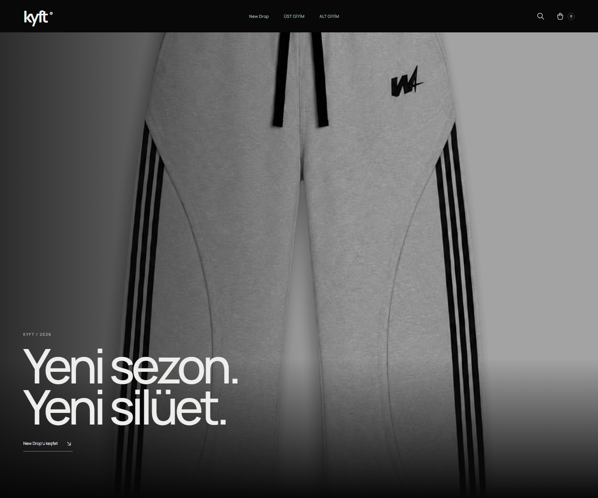

# KYFT Store

Ürün kataloğu, filtreler ve sepet akışı sunan streetwear mağaza arayüzü.

**Canlı demo:** [kyft.netlify.app](https://kyft.netlify.app/)



## Ne yapıyor?

- Koleksiyonları ve kategori sayfalarını gösterir; ürün aramayı ve filtrelemeyi sağlar.
- Ürün detayında görselleri, renk/beden seçeneklerini ve örnek fiyatları sunar.
- Sepete ürün ekleme, adet değiştirme ve kaldırma akışını gösterir.
- Telefon ekranı ve azaltılmış hareket tercihi için uyarlamalar içerir.

## Kullanılan teknolojiler

Astro, HTML, CSS, TypeScript, Tailwind CSS ve GSAP. Statik yayın Netlify üzerinde yapılır. Kalıcı sunucu veritabanı kullanılmaz.

## Nasıl çalışır?

Ürün bilgileri `src/data/products.ts` ve sayfa kaynaklarından okunur; Astro bunları statik sayfalara dönüştürür. Sepet `localStorage` içinde saklanır. Hesap sayfası yalnız tarayıcı demosudur: profil ve örnek oturum tarayıcıda tutulur; sunucuda parola doğrulayan üyelik sistemi yoktur. Şifre sıfırlama e-postası gönderilmez.

Gerçek ödeme, stok yönetimi, sipariş oluşturma ve merkezi kullanıcı hesabı bağlı değildir. Gerçek şifre veya kişisel bilgi kullanılmamalıdır. Ürün bilgileri ve görseller portföy gösterimi içindir.

## Çalıştırma

Node.js 22.12 veya üzeri:

```sh
npm ci
npm run dev
npm run check
npm run build
npm run preview
```

Üretim çıktısı `dist/` klasörüdür. Netlify ayarları `netlify.toml` içindedir.

## Doğrulama

Astro kontrolünde hata/uyarı bulunmadı; üretim derlemesinde 21 statik sayfa oluşturuldu. Ayrıntılar `VALIDATION.md` içinde.

## Yapay zekâ kullanımı

Yapay zekâ destekli geliştirme araçlarıyla geliştirildi. Tasarım, içerik, özellik kapsamı ve revizyonlar tarafımdan yönlendirildi; kod üretimi ve hata çözümünde bu araçlardan yararlanıldı. Aşağıdaki doğrulama notları bu GitHub sürümünün hazırlığına aittir. Bazı ürün görselleri de yapay zekâ araçlarıyla oluşturuldu. Görsellerin bulunması, üçüncü taraf marka ve tasarımlar için yeniden kullanım izni vermez.
